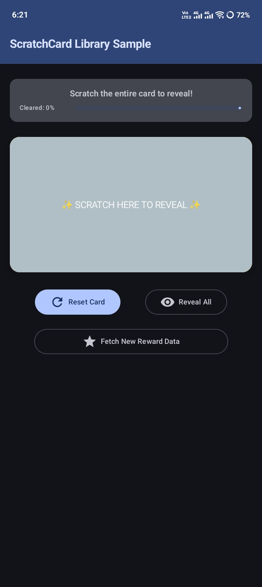
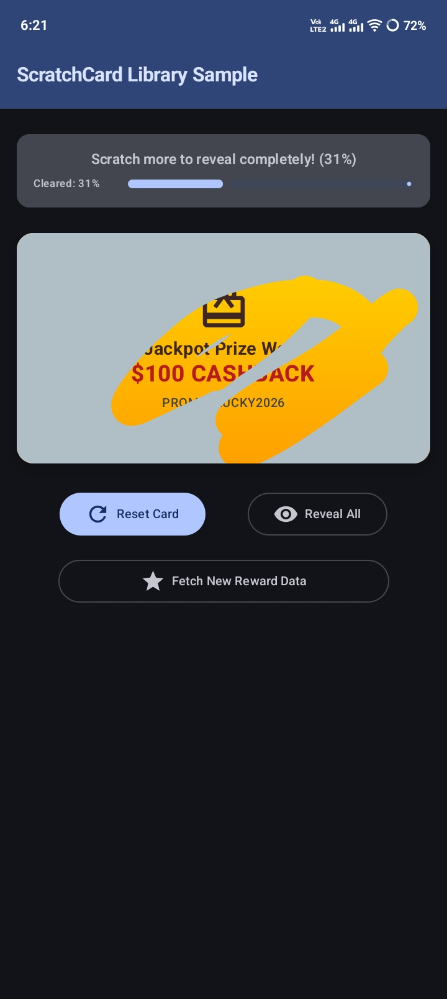
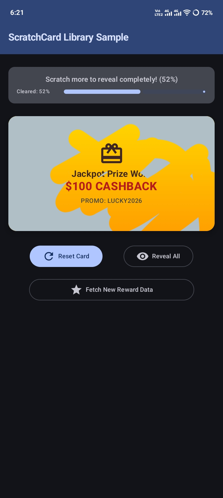
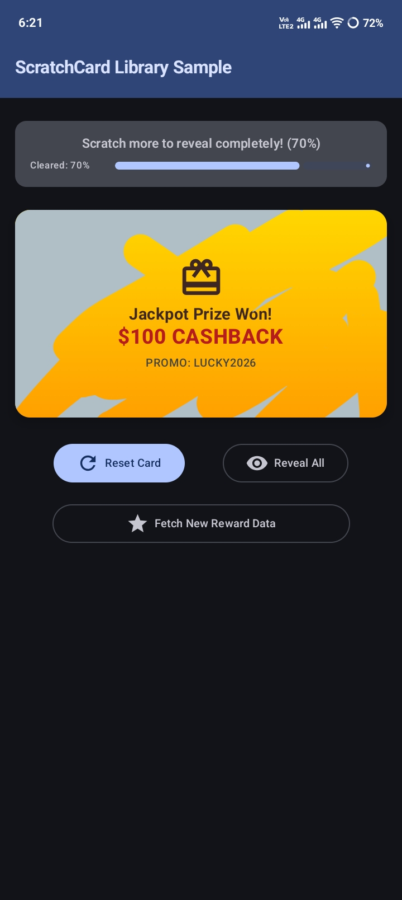
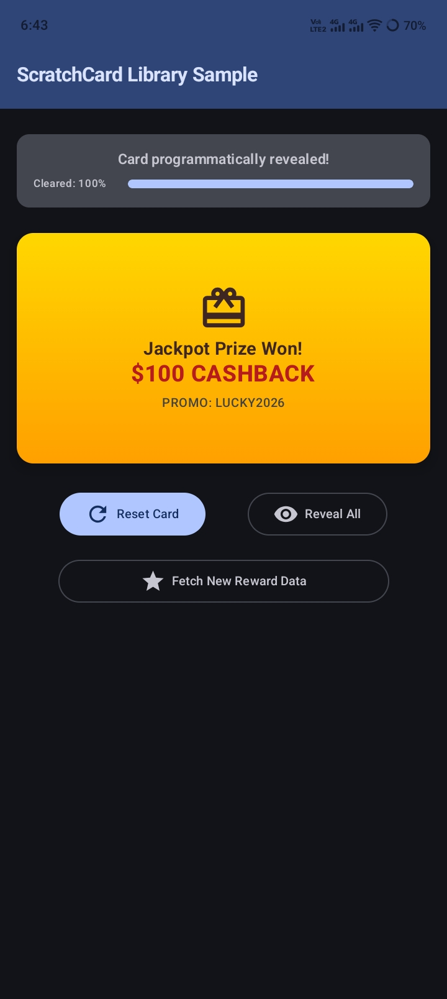

# 🪙 ScratchCard-Andorid

A modern, high-performance, open-source Android library for Jetpack Compose that provides customizable **Scratch-to-Reveal** cards with hardware-accelerated masking and real-time touch gesture tracking.

Built 100% with declarative Jetpack Compose UI and Compose Canvas graphics—no legacy Android Views, external canvas wrappers, or bitmap overhead.

---

<div align="center">

[](https://jitpack.io/#Aptic-Studio/ScratchCard-Android)
[](LICENSE)
[](https://developer.android.com)

📱 **[Try Demo APK (Google Drive)](https://drive.google.com/file/d/1z9QQwsmwJdvBlPf5BROMAnIPBNX1y4V2/view?usp=sharing)**

---

### 📸 Scratch Progression Preview

| 0% Cleared | 31% Cleared | 52% Cleared | 70% Cleared | 100% Cleared |
| :---: | :---: | :---: | :---: | :---: |
|  |  |  |  |  |

</div>

---

## ✨ Features

- ⚡ **Hardware-Accelerated Masking**: Uses `CompositingStrategy.Offscreen` combined with `BlendMode.Clear` (PorterDuff CLEAR mode) to slice through top overlay layers smoothly.
- 🎨 **Fully Customizable Overlay**: Supports solid colors, custom `ImageBitmap`, `Painter` assets, and optional text hints (e.g. *"Scratch Here!"*).
- 🖼️ **Flexible Background Layout Slot**: Accepts a `@Composable () -> Unit` trailing lambda. Stream database images, remote API network assets, promotional codes, or custom animated views underneath.
- 📊 **Real-Time Progress Tracking**: Accurately calculates cleared scratch percentage in real-time.
- 🎯 **Completion Callbacks & Auto-Clear**: Automatically triggers completion hooks when customizable threshold (e.g. 50%) is reached.
- 🔄 **Stateful Control**: Programmatically `reset()` or `clear()` scratch states with `rememberScratchCardState()`.

---

## 📦 Installation

### 1. Add Repository to `settings.gradle.kts`

Add JitPack (or Maven Central) to your project's repository resolution settings:

```kotlin
dependencyResolutionManagement {
    repositoriesMode.set(RepositoriesMode.FAIL_ON_PROJECT_REPOS)
    repositories {
        google()
        mavenCentral()
        maven { url = java.net.URI("https://jitpack.io") }
    }
}
```

### 2. Add Dependency to `build.gradle.kts`

Add the `ScratchCard` dependency to your module's `build.gradle.kts`:

```kotlin
dependencies {
    implementation("com.github.Aptic-Studio:ScratchCard-Android:v1.0.1")
}
```

Or for local multi-module projects:

```kotlin
dependencies {
    implementation(project(":ScratchCard"))
}
```

---

## 🚀 Quick Start

```kotlin
import androidx.compose.foundation.layout.fillMaxSize
import androidx.compose.foundation.layout.height
import androidx.compose.material3.Text
import androidx.compose.runtime.Composable
import androidx.compose.ui.Modifier
import androidx.compose.ui.graphics.Color
import androidx.compose.ui.unit.dp
import com.apticstudio.scratchcard.ScratchCard
import com.apticstudio.scratchcard.rememberScratchCardState

@Composable
fun QuickScratchCardSample() {
    val scratchState = rememberScratchCardState()

    ScratchCard(
        modifier = Modifier.height(200.dp),
        state = scratchState,
        overlayColor = Color(0xFFC0C0C0), // Silver scratch surface
        overlayText = "SCRATCH TO WIN!",
        scratchThickness = 32.dp,
        clearThreshold = 0.6f,
        autoClearOnThreshold = true,
        onScratchCompleted = {
            println("Reward unlocked!")
        }
    ) {
        // Hidden background content
        Text(
            text = "🎉 YOU WON $100 CASHBACK! 🎉",
            modifier = Modifier.fillMaxSize()
        )
    }
}
```

---

## 🗄️ Streaming Database / API Textures

You can place any layout, image fetcher (e.g., Coil `AsyncImage`), or database query result inside the trailing `@Composable` slot:

```kotlin
val rewardFromDatabase = repository.getRewardFlow().collectAsState(initial = null)

ScratchCard(
    modifier = Modifier.fillMaxWidth().height(240.dp),
    overlayColor = Color(0xFFD4AF37), // Gold Overlay
    overlayText = "✨ SCRATCH FOR DAILY GIFT ✨"
) {
    rewardFromDatabase.value?.let { reward ->
        RewardCardContent(
            imageUrl = reward.imageUrl,
            couponCode = reward.code,
            amount = reward.amount
        )
    } ?: CircularProgressIndicator()
}
```

---

## ⚙️ Component Signature & Parameters

```kotlin
@Composable
fun ScratchCard(
    modifier: Modifier = Modifier,
    state: ScratchCardState = rememberScratchCardState(),
    overlayColor: Color = Color(0xFFC0C0C0),
    overlayImage: ImageBitmap? = null,
    overlayPainter: Painter? = null,
    overlayText: String? = null,
    scratchThickness: Dp = 32.dp,
    enabled: Boolean = true,
    clearThreshold: Float = 0.5f,
    autoClearOnThreshold: Boolean = false,
    onScratchStarted: () -> Unit = {},
    onScratchProgress: (progress: Float) -> Unit = {},
    onScratchCompleted: () -> Unit = {},
    content: @Composable () -> Unit
)
```

| Parameter | Type | Default | Description |
| :--- | :--- | :--- | :--- |
| `modifier` | `Modifier` | `Modifier` | Customizes bounds, size, and layout properties. |
| `state` | `ScratchCardState` | `rememberScratchCardState()` | Controls scratch state, reset, clear, and progress. |
| `overlayColor` | `Color` | `Color(0xFFC0C0C0)` | Solid background color of the top scratch layer. |
| `overlayImage` | `ImageBitmap?` | `null` | Optional bitmap texture rendered on top overlay. |
| `overlayPainter` | `Painter?` | `null` | Optional painter asset rendered on top overlay. |
| `overlayText` | `String?` | `null` | Text hint displayed on overlay before scratching starts. |
| `scratchThickness` | `Dp` | `32.dp` | Eraser stroke diameter / brush thickness. |
| `enabled` | `Boolean` | `true` | Whether drag gestures scratch the overlay. |
| `clearThreshold` | `Float` | `0.5f` | Progress ratio (0.0 - 1.0) required to complete scratch. |
| `autoClearOnThreshold`| `Boolean` | `false` | Automatically clears remaining overlay when threshold met. |
| `onScratchStarted` | `() -> Unit` | `{}` | Callback fired when user begins scratching. |
| `onScratchProgress` | `(Float) -> Unit`| `{}` | Fired during scratch drag with current progress fraction. |
| `onScratchCompleted` | `() -> Unit` | `{}` | Fired when scratch progress reaches `clearThreshold`. |
| `content` | `@Composable () -> Unit` | Required | Background content revealed beneath the scratch layer. |

---

## 🎮 `ScratchCardState` API

The `ScratchCardState` object exposes reactive state and programmatic controls:

- `state.progress: Float`: Current cleared fraction from `0.0f` to `1.0f`.
- `state.isCleared: Boolean`: Indicates if overlay is programmatically cleared or auto-cleared.
- `state.reset()`: Resets all recorded paths and progress back to initial covered state.
- `state.clear()`: Instantly clears/reveals the entire scratch card.

---

## 🧠 Mechanics & Architecture

1. **Sequential Stacking**: Elements are stacked in a `Box` layout with bottom layer (`content`) underneath top layer (`Canvas`).
2. **Gesture Capture**: `pointerInput` listens for touch drag events, constructing continuous `Path` vectors with `moveTo` and `lineTo`.
3. **Offscreen Compositing & Masking**: The Canvas layer uses `graphicsLayer(compositingStrategy = CompositingStrategy.Offscreen)`. Touch paths are rendered with `BlendMode.Clear`, erasing pixels on the offscreen overlay buffer to reveal the underlying content cleanly without lag.

---

## 📄 License

```text
Copyright 2026 ApticStudio

Licensed under the Apache License, Version 2.0 (the "License");
you may not use this file except in compliance with the License.
You may obtain a copy of the License at

   http://www.apache.org/licenses/LICENSE-2.0

Unless required by applicable law or agreed to in writing, software
distributed under the License is distributed on an "AS IS" BASIS,
WITHOUT WARRANTIES OR CONDITIONS OF ANY KIND, either express or implied.
See the License for the specific language governing permissions and
limitations under the License.
```
